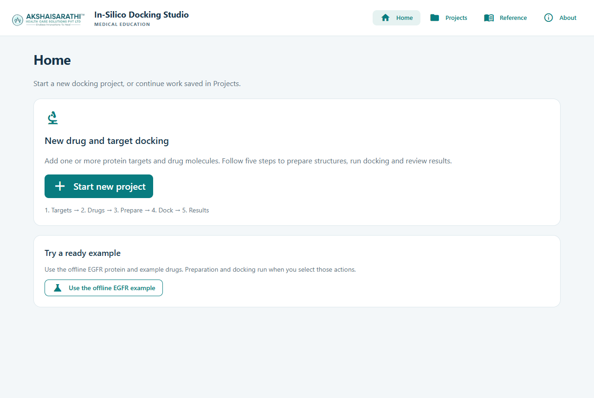

# In-Silico Docking Studio

Molecular docking software for medical education, with a clear five-step
workflow and local AutoDock Vina calculations. No quiz questions or written
answers are required. An LLM or Ollama installation is not needed.

## Download and install

**[Public release and all downloads](https://github.com/ManuHCI/multiagent-docking-gui/releases/tag/v1.3.0)**

| Computer | Installer |
| --- | --- |
| Windows 10/11, 64-bit | [Download Windows setup](https://github.com/ManuHCI/multiagent-docking-gui/releases/download/v1.3.0/InSilicoTeachingSuite-1.3.0-Setup.exe) |
| Mac with Apple silicon, macOS 15 or newer | [Download Apple silicon DMG](https://github.com/ManuHCI/multiagent-docking-gui/releases/download/v1.3.0/InSilicoDockingStudio-1.3.0-macOS-arm64.dmg) |
| Intel Mac, macOS 15 or newer | [Download Intel Mac DMG](https://github.com/ManuHCI/multiagent-docking-gui/releases/download/v1.3.0/InSilicoDockingStudio-1.3.0-macOS-x86_64.dmg) |

The installers include Python and the scientific tools. On Windows, run
setup and open the installed shortcut; [Microsoft Edge WebView2 Runtime](https://developer.microsoft.com/en-us/microsoft-edge/webview2/) is
required. On Mac, open the DMG and drag the app into Applications. Mac ZIP
alternatives and SHA256 checksums are also listed in the release.

The public binaries are not signed with a publisher certificate or notarized
by Apple. Windows may display a publisher prompt. On Mac, first launch may
require approval in System Settings > Privacy & Security. See
[Mac installation](MACOS.md) and [Windows installation](DESKTOP.md).



## Four clear sections

- **Home:** Start a new drug and target docking project or try the offline example.
- **Projects:** Reopen saved work, see disk sizes, or delete a selected project after confirmation.
- **Reference:** Scientific references, protein/drug download links and methods export.
- **About:** Logo and full developer credits.

Inside a project, follow **Targets → Drugs → Prepare → Dock → Results**.
Add multiple proteins and drugs to calculate every target–drug combination.
Each target keeps its own preparation, binding box, results and scientific
checks. Review poses in 3D and export a CSV or complete project ZIP with
structures, methods, parameters, sources and references.

Local PDB/mmCIF files, SMILES/SDF molecules and the bundled EGFR example work
offline. New RCSB/PubChem retrieval requires internet. A completed calculation
can still have a failed scientific check; the outcome stays visible.

## Saved work

Projects are separate from the installed application and are retained on
update or uninstall:

- Windows: `%LOCALAPPDATA%\InSilicoTeachingSuite\Projects`
- Mac: `~/Library/Application Support/InSilicoTeachingSuite/Projects`

Saved projects occupy disk space; their molecular data is loaded when opened.
Export a complete ZIP before deleting a project or moving it between machines.
Earlier individual projects remain available from Projects. Your own projects
and settings are excluded from this public source repository.

## Developers

**Dr Manu Kumar Shetty**, Professor, Department of Pharmacology,
Maulana Azad Medical College, New Delhi.

**Dr Pratibha Nadig**, Founder, Akshaisarathi Healthcare.

## Source and builds

```sh
git clone https://github.com/ManuHCI/multiagent-docking-gui.git
cd multiagent-docking-gui
conda env create -f environment.yml
conda activate insilico
python app.py
```

For Mac source use `environment-macos.yml` instead. See [MACOS.md](MACOS.md).
The Windows source environment also needs the official bundled `vina.exe`.
For a desktop source window, install pywebview and run `python desktop.py`.
Use [DESKTOP.md](DESKTOP.md) for Windows packaging. GitHub's **Build macOS
applications** workflow builds and verifies Apple silicon and Intel apps.

The previous local-LLM application remains in the
[archived branch](https://github.com/ManuHCI/multiagent-docking-gui/tree/archive/pre-docking-studio-20261108)
and its original version tags. This repository now opens Docking Studio.

## Interpretation and licence

For medical education and exploratory in-silico studies. Docking scores and
poses do not establish potency, selectivity, clinical benefit or safety.
Compare scores within each target's setup and review the recorded checks.

Project source is MIT licensed; scientific dependencies retain their own
licences. Full Vina and 3Dmol notices accompany the bundled assets. Use
**Reference** and the exported methods to cite the tools and data actually used.
